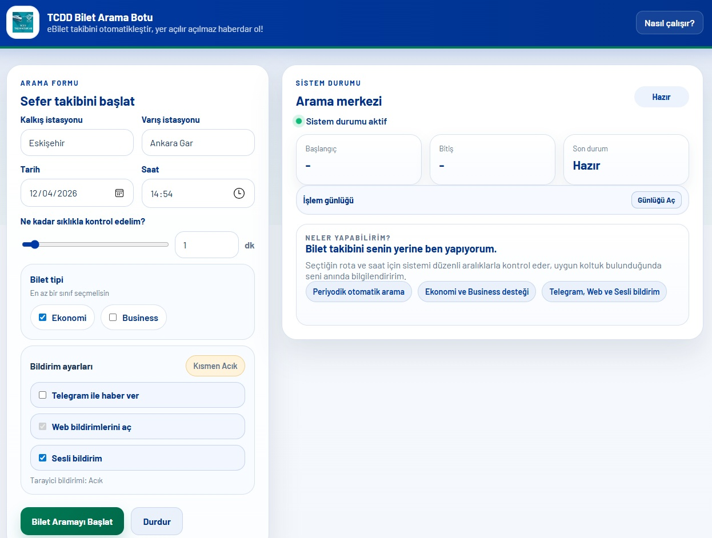

[](https://github.com/mcagriaksoy/tcdd-bilet-yer-kontrol "Go to GitHub repo")
[](https://github.com/mcagriaksoy/tcdd-bilet-yer-kontrol)
[](https://github.com/mcagriaksoy/tcdd-bilet-yer-kontrol)
[](https://github.com/mcagriaksoy/tcdd-bilet-yer-kontrol/releases/)
[](#license)
[](https://github.com/mcagriaksoy/tcdd-bilet-yer-kontrol/issues)

## Güncelleme (Kasım 2026)

> **Önemli:** TCDD eBilet artık seçilen sefer ve vagonda boş yer oluştuğunda
> bildirim gönderen yerleşik bir **"Alarm Oluştur"** özelliği sunuyor.
> Bu nedenle proje, çoğu kullanıcı için ihtiyaç duyulan işlevi artık doğrudan
> TCDD tarafından karşılanmaktadır.
>
> - Uygulama **kullanılmaya devam edilebilir**, ancak bundan sonra ağırlıklı
>   olarak **eğitim ve kişisel kullanım** amacıyla sürdürülmektedir.
> - Boş yer takibi ihtiyacınız için öncelikle TCDD eBilet'in kendi
>   **Alarm Oluştur** özelliğini kullanmanız önerilir.
> - Yeni bir özellik talep etmek veya bir sorun bildirmek isterseniz lütfen
>   [issue açın](https://github.com/mcagriaksoy/tcdd-bilet-yer-kontrol/issues).

Bu proje TCDD eBilet tarafinda secilen rota/saat icin bos koltuk durumunu periyodik olarak kontrol eder. Bu uygulama, yolcuların bilet bilgilerini hızlı ve kolay bir şekilde aramalarina ve doğrulamalarına olanak tanır.

## Mimari

Tek bir kullanici arayuzu vardir: yerel web arayuzu. Uygulama acildiginda
Flask sunucusu baslar ve arayuz native bir masaustu penceresinde gosterilir.
Kullaniciya ayri bir tarayici penceresi acilmaz.

- `backend`: Ortak algoritma katmani (Selenium, rota, koltuk kontrolu, bildirimler)
- `webapp`: Tek kullanici arayuzu (Flask + template/static/routes)
- `start_ui.py`: Tek giris noktasi (sunucuyu baslatir, native pencereyi acar)

## Ozellikler

- Periyodik otomatik koltuk kontrolu
- Telegram bildirimi (opsiyonel)
- Web bildirim + sesli bildirim
- Tek ekrandan canli durum ve islem gunlugu
- Ilk acilista WebDriver'i otomatik indirme
- Guvenlik dogrulamasi (CAPTCHA) algilandiginda kontrolu duraklatip manuel cozum bekleme

## Kurulum

```powershell
pip install -r requirements_web.txt
```

Not:
- Selenium + Edge kullanildigi icin sistemde Microsoft Edge ve uygun `msedgedriver` olmalidir.
- Proje kokunde `msedgedriver.exe` varsa dogrudan kullanilir; yoksa ilk acilista otomatik indirilir.
- Arayuz `pywebview` ile native pencerede gosterilir. Windows'ta WebView2 kullanilir (Windows 10/11'de hazir gelir).
- Linux'ta native pencere icin Qt bagimliliklari gerekir: `pip install "pywebview[qt]"`.

## Windows EXE (Hazir Surum)

Kurulum yapmadan kullanmak isteyenler son hazir `.exe` surumunu GitHub Releases sayfasindan indirebilir:

- https://github.com/mcagriaksoy/tcdd-bilet-yer-kontrol/releases

Releases sayfasindan en guncel surumdeki `tcdd-bilet-botu.exe` dosyasini indirip calistirabilirsiniz.

## Calistirma

```powershell
python start_ui.py
```

Uygulama sunucuyu baslatir ve arayuzu native bir masaustu penceresinde acar.
Varsayilan adres (yalnizca yerel sunucu icin):

```
http://127.0.0.1:5001
```

Faydali secenekler:

```powershell
python start_ui.py --port 8080       # farkli port kullan
python start_ui.py --host 0.0.0.0    # agdan erisime ac
python start_ui.py --browser         # gelistirici: pencere yerine tarayici
```

Port doluysa uygulama otomatik olarak bos bir port secer. Pencereyi kapatmak
uygulamayi ve sunucuyu da kapatir. Terminalden calistiriliyorsa `Ctrl+C` de kullanilabilir.

`TCDD_WEB_PORT` ve `TCDD_WEB_HOST` ortam degiskenleri de desteklenir.

## Guvenlik Dogrulamasi (CAPTCHA)

TCDD bazen arama oncesinde Cloudflare Turnstile / reCAPTCHA tarzi bir guvenlik
dogrulamasi gosterebilir. Bu durumda uygulama:

1. Dogrulamayi algilar ve kontrolu otomatik olarak duraklatir.
2. Arayuzde "Guvenlik Dogrulamasi Gerekli" uyarisini gosterir.
3. Selenium ile acilan Edge penceresini one getirir.
4. Kullanici dogrulamayi tamamlayana kadar (varsayilan 3 dakika) bekler.
5. Dogrulama tamamlaninca kontrole kaldigi yerden devam eder.

Onemli: CAPTCHA otomatik olarak cozulmez. Bu adim, guvenlik dogrulamasini
atlatmak icin degil, kullaniciya manuel tamamlama firsati vermek icin vardir.
Telegram bildirimi aciksa dogrulama gerektigi Telegram uzerinden de bildirilir.

## Loglar

Calisma loglari proje kokundeki `logs/` klasorunde tutulur:

- `logs/app.log`
- `logs/tcdd_web_debug.log`

## Ekran Goruntusu



## Domain Ile Yayina Alma

Web arayuzu domain ile yayina alinabilir. Arayuzun arkasinda Selenium calistigi
icin standart "statik site" gibi degil, bir sunucuda process olarak calismasi gerekir.

Gerekenler:
1. Linux/Windows (7/24 acik)
2. Python + Edge + `msedgedriver`
3. Flask uygulamasini proses yoneticisi ile calistirma (systemd, pm2, supervisor vb.)
4. Domain DNS -> sunucu IP
5. Nginx/Caddy reverse proxy + HTTPS (Let's Encrypt)

Onemli notlar:
- Uygulama varsayilan olarak yalnizca `127.0.0.1` dinler. Agdan erisim icin `--host 0.0.0.0` kullanin ve mutlaka bir reverse proxy + kimlik dogrulama ekleyin.
- Uzun sureli Selenium isleri CPU/RAM tuketir; dusuk kaynakli hostinglerde yavaslayabilir.
- TCDD tarafindaki HTML degisirse `backend` icindeki selectorler guncellenmelidir.

## Gelistirici Notu

Tek algoritma kaynagi `backend` klasorudur. `webapp` icine kopya algoritma
dosyasi eklenmemelidir. Tek arayuz `webapp` altindadir; ikinci bir masaustu
arayuzu eklenmemelidir.

## Paket Hazirlama

Lint ve analiz:

```powershell
ruff check .
python -m compileall -q start_ui.py webapp backend
```

Paket olusturma:

```powershell
python -m build
python -m twine check dist\tcdd_bilet_yer_kontrol-5.0.0.tar.gz
python -m twine check dist\tcdd_bilet_yer_kontrol-5.0.0-py3-none-any.whl
```

TestPyPI/PyPI yukleme:

```powershell
python -m twine upload --repository testpypi dist/*
python -m twine upload dist/*
```

Paket kurulduktan sonra gelen komutlar:
- `tcdd-launcher`: tek giris noktasi (onerilen)
- `tcdd-web`: yalnizca sunucuyu baslatir

## Lisans

Proje GPL-3.0 ile lisanslidir. Detay: `LICENSE`.

<a href="https://www.buymeacoffee.com/mcagriaksoy" target="_blank"></a>
